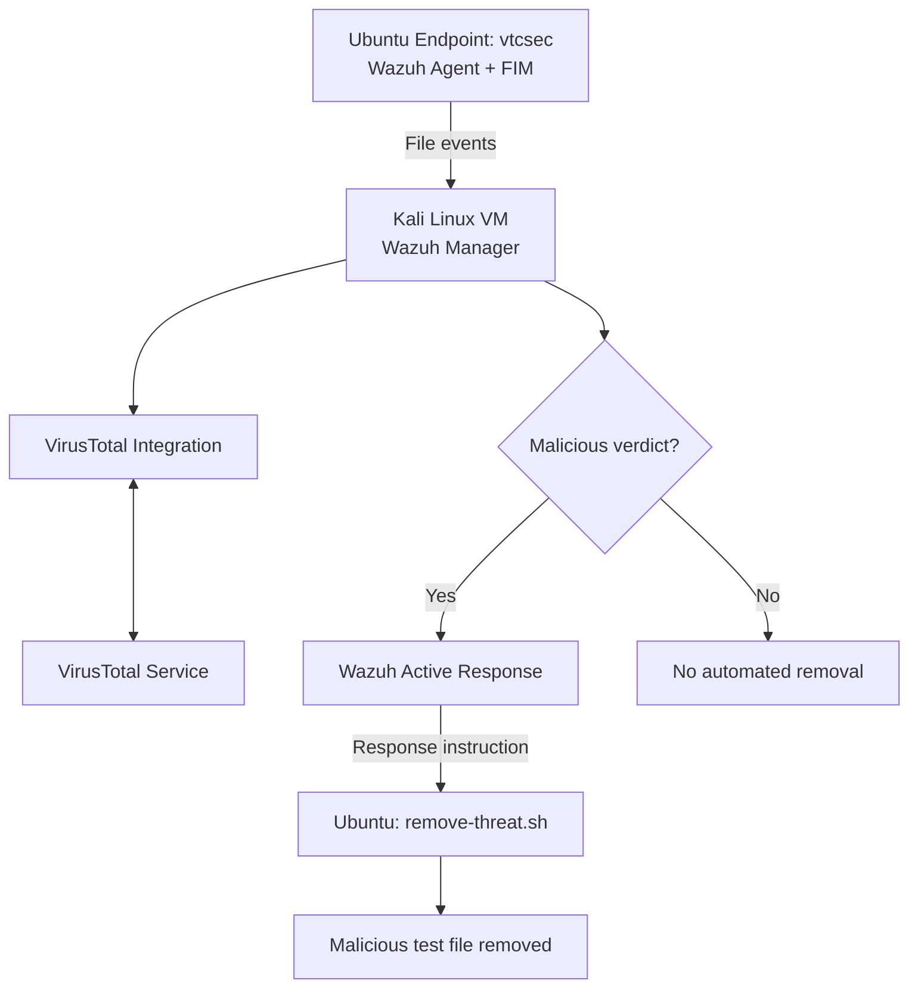

# Wazuh Threat Detection & Automated Response

## Overview
A hands-on Security Operations Center (SOC) lab demonstrating file integrity monitoring, threat intelligence enrichment, malicious file detection, and automated containment using Wazuh and VirusTotal.

## Architecture
Ubuntu Endpoint → Wazuh FIM → Wazuh Manager → VirusTotal Enrichment → Active Response → File Containment

## Technologies
- Wazuh SIEM and endpoint monitoring
- VirusTotal threat intelligence
- Linux (Ubuntu and Kali Linux)
- File Integrity Monitoring (FIM)
- Wazuh custom detection rules
- Automated incident response

## Detection and Response Workflow
1. Wazuh monitors files on the Ubuntu endpoint.
2. File creation or modification generates a security event.
3. VirusTotal enrichment checks the file hash.
4. A malicious verdict triggers Wazuh Active Response.
5. The response script removes the identified test file.
6. Wazuh logs are reviewed to verify the outcome.

## Validation Results
- **Benign-file tests:** 5/5 passed, with zero unwanted removals.
- **EICAR test trials:** 3/3 successfully contained.
- **Average detection-to-containment time:** approximately 9.0 seconds.
- **Average malicious-verdict-to-containment time:** approximately 67 milliseconds.

These results reflect controlled lab tests, not production performance guarantees.

## Skills Demonstrated
- SIEM alert analysis
- File integrity monitoring
- Threat intelligence integration
- Detection rule configuration
- Linux troubleshooting
- Security automation
- Incident validation and documentation

## Safety Notice
Testing was conducted in a controlled lab using the EICAR antivirus test file. This project is for educational and defensive security purposes.

## Architecture Diagram

## Author
Kingfisher573 — Aspiring SOC Analyst
